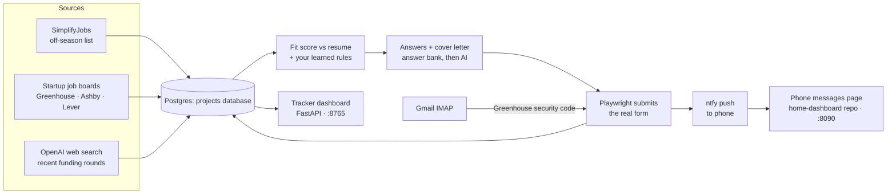

<div align="center">

# Winter 2027 Internship Agent

**Finds the internships worth my time, scores each against my resume, drafts the outreach, and applies.**<br>
Outreach emails are sent only after I confirm; applications go out daily for complete Greenhouse, Ashby and Lever forms.


[What it does](#what-it-does) · [Architecture](#architecture) · [Dashboard](#dashboard) · [Outlook](#outlook-integration-mcp) · [Development](#development)


<sub>A startup's fit and draft, a posting's prepared answers, and the rules learned from notes. Every company and person shown is made up.</sub>

</div>

## What it does

A local-first agent for finding Winter 2027 software-engineering internships, matching them against Aarav Modi's resume, and preparing application materials.

<table>
<tr>
<td width="33%" valign="top">

**Scored against the resume**

Each lead gets a fit score, the reasons for it, and what to lead with.


</td>
<td width="33%" valign="top">

**Drafts you edit, then send yourself**

Sending takes a second confirming click, and a guessed address has to be checked first.


</td>
<td width="33%" valign="top">

**Application answers, prepared**

Written from the resume for a posting's real form. Eligible, complete forms can be submitted by the saved browser session.


</td>
</tr>
</table>

**Recently funded startups first.** Web search finds funding rounds from the last 60 days in Canada, the USA and Europe. A result is kept only if its cited article loads and names both the company and the founder.

<p align="center"></p>

**It learns from your notes.** "This one needs French, not applying" becomes a rule, and every later lead is scored against it.

<p align="center"></p>

## Architecture



| Part | Where | What it does |
|---|---|---|
| Sources | `sources/simplify.py`, `sources/startup_jobs.py`, `sources/startups.py` | Collect Winter 2027 postings and recently funded startups; every lead keeps its source URL |
| Storage | `db.py`, `leads/store.py`, `leads/schemas.py` | Tables `intern_agent_leads` (one JSONB row per lead: fit, drafts, application state), `_preferences`, `_answer_bank`, `_sent_log`, `_openai_usage` and `_xai_usage` in the shared `projects` Postgres database (`db.py`) when `DATABASE_URL` is set; otherwise the same data as files in `data/` |
| Scoring | `workflows.score`, `ai.py`, `leads/preferences.py` | Fit 0-100 from the resume and posting text; your notes become skip/boost rules |
| Answers | `workflows.prepare_application`, `leads/answers.py`, `sources/application_form.py` | Reads the posting's real form; personal questions come from `data/answer-bank.json`, the rest are AI-written |
| Submission | `applications/browser.py`, `applications/verification_mail.py` | Fills and submits the form in a saved browser profile; reads Greenhouse's emailed code from Gmail; marks anything it can't confirm `uncertain` and never retries it on its own |
| Daily run | `workflows.daily`, `leads application-campaign` | Scrape, score new postings, then submit 20 applications, lowest fit first; one ntfy summary |
| Dashboard | `dashboard/app.py`, `dashboard/index.html` | Browse leads, edit drafts and answers, Auto-apply one job (on its own term), reopen an attempt you confirmed never sent |
| Outreach | `mailer.py`, `leads/sending.py`, `followup_run.py` | Gmail sends after a confirming click; follow-ups at most twice per person |
| Opportunities | `opportunities/` | Hackathons, tech conferences, research venues and networking events; a submission strategy per venue (see [Opportunity agent](#opportunity-agent)) |

**On the server** (a MacBook on Tailscale), Docker Compose runs the dashboard at
`http://100.76.57.23:8765`. Pushing to `main` deploys within a minute. Systemd timers run
`scripts/run-daily-job-scrape.sh` at 7:30 AM and `scripts/run-daily-applications.sh` at 8:00 AM
Toronto time. n8n handles replies and follow-ups. Every ntfy push, from this agent or any other
app, is kept and shown by the separate messages service in the
[home-dashboard](https://github.com/aaravhmodi/home-dashboard) repo.

## Current setup

- Resume source: `../website/public/ModiAaravResume.pdf`
- Tailoring context: [`candidate_context.md`](candidate_context.md), including public portfolio
  facts and clearly marked candidate-provided notes
- Outlook Email and Outlook Calendar: optional, read-only inputs when connected
- LinkedIn: public-page discovery only until a supported connector is available
- Application submission: browser driven for Greenhouse, Ashby, and Lever postings; Workday,
  CAPTCHA pages, unsupported sites, and forms with unanswered required fields are skipped

## Outlook integration (MCP)

Outlook mail and calendar are read through the
[Softeria Microsoft 365 MCP server](https://github.com/Softeria/ms-365-mcp-server),
launched over stdio with `--read-only --preset mail,calendar`. The Python client in
`src/internship_agent/outlook/` additionally only calls an allowlist of read tools
(`verify-login`, `list-mail-messages`, `get-mail-message`, `get-calendar-view`).
Microsoft's official Work IQ Mail/Calendar MCP servers were not used because they need
an M365 Copilot license and tenant admin registration, and don't support personal accounts.

Requirements: Python 3.12, [uv](https://docs.astral.sh/uv/), Node.js (for `npx`).

```text
uv sync
cp .env.example .env              # set OUTLOOK_ORG_MODE=true for a uwaterloo.ca mailbox
uv run internship-agent outlook login    # device-code sign-in; tokens go to the OS credential store
uv run internship-agent outlook status
uv run internship-agent inbox            # recruiting emails grouped by stage
uv run internship-agent interviews --days 30
```

`.mcp.json` registers the same read-only server for Claude Code sessions opened in this
folder. Run the login step first so it can reuse the cached token.

## Dashboard

```text
uv run internship-agent dashboard        # http://127.0.0.1:8765 (local only)
```

Two searches, shown separately:

- **Startups** (early = pre-seed/seed, mid = Series A-D) are the priority. "Search for startups"
  runs OpenAI web search for funding rounds from the last 60 days in Canada, the USA and Europe
  (`SEARCH_REGIONS`), each through funding news, X posts and LinkedIn posts. Each new startup's
  public job board (Ashby, Greenhouse, Lever) is checked for open intern/co-op roles. A result is kept only if its cited
  article loads and names both the company and the founder. Also from the CLI:
  `leads find-startups --stage early --stage mid --count 8`.
- **Big companies**: open Winter 2027 postings from the public
  [SimplifyJobs off-season list](https://github.com/SimplifyJobs/Summer2027-Internships/blob/dev/README-Off-Season.md).
  "Mark applied" tops the open list back up to `TARGET_OPEN_POSTINGS` (default 15); postings
  you applied to or skipped are never re-added.

Select a company to see its fit score and reasons, contact, and editable drafts:

- **Send email** sends from Gmail after a second confirming click. Guessed addresses need
  "I've checked this address" ticked; a lead is never emailed twice unless you choose
  "Send again". Sends are logged to `data/sent-log.jsonl`. Setup: turn on 2-Step Verification,
  create an app password at https://myaccount.google.com/apppasswords, and put it in `.env` as
  `GMAIL_APP_PASSWORD` (with `GMAIL_ADDRESS`). Never use your normal Google password.
- **LinkedIn**: copies the connection note and opens the profile (or a people search). LinkedIn
  forbids automated invitations, so you paste and send it.
- **More people to connect with**: "Find people" runs a web search for about five other people
  at the company, chosen by its size: founders and first engineers at an early-stage startup;
  engineering managers, recruiters and engineers (not the co-founders) at a mid-stage one;
  campus recruiters and the team's manager and engineers at a big company. Each needs a source
  page that names them and the company; a LinkedIn source cannot be read by a script, so check
  the profile before you send. New startups get this automatically when they are found.
- **Applications**: run `uv run playwright install chromium`, then
  `uv run internship-agent leads browser-login` once to sign in to the job sites you use.
  The daily run prepares tailored answers and submits 20 complete Greenhouse, Ashby, and
  Lever forms a day, lowest fit score first, and skips terms outside January-April.
  **Auto-apply** on a job applies to that one job even outside January-April: its term,
  availability and date answers and the cover letter are rewritten to match that posting.
  After a submit, the job shows a result card: **✓ Submitted** with the time, the employer's
  own confirmation line and a screenshot of their confirmation page (kept in
  `data/application-browser/confirmations/`), or the reason it wasn't submitted.
  **Wasn't submitted, allow retry** reopens an `uncertain` attempt after you have checked
  your email and the job site. Workday, CAPTCHA pages, unsupported sites, and forms
  with missing required answers are left for you; the ntfy summary reports submitted and
  blocked/failed counts. `internship-agent leads apply <company/contact-key> --dry-run` fills
  a form without submitting it.
  The server scrapes at 7:30 AM Toronto (then adds Form D founder leads, below) and runs
  applications at 8:00 AM through systemd
  timers (20 lowest-scored by default; `--skip-strong` leaves green strong fits for you).
  The daily run scores only new eligible postings and reuses prepared materials. Compact job context and GPT-6 Luna keep
  AI token usage low.
  Token counts for scoring, answers, and cover letters are recorded without prompt content in
  `data/openai-usage.jsonl`; the ntfy summary includes a token-based cost estimate.

**Notes (bottom of the side panel).** Type why you're skipping something or what you want
more of, e.g. "this one needs French, not applying". With a company selected, the note is saved
on it and its status is updated if you say you skipped, applied, or reached out. The AI also
turns reusable notes into rules ("Skip roles that require French", "Prefer early-stage AI
startups"), listed under **Learned > Your rules**, where you can forget them. Rules are applied
whenever leads are scored: scoring reads each posting's description, lowers or raises scores
for downrank/boost rules, and auto-skips leads that clearly break a skip rule (company-wide
boilerplate does not count). "Re-check to-do leads" re-scores everything against your rules.

The server only answers requests from localhost (and the hosts in `DASHBOARD_ALLOWED_HOSTS`,
the Tailscale address on the home server) and rejects cross-site requests, because it can send
email and submit applications.

## Founder leads (X.com)

Find founders who recently raised (pre-seed to Series A) and might take a Winter 2027 intern:

1. In Claude Code, run `/find-founders 10 AI infra`. Claude uses Claude in Chrome to read
   X search, founder profiles and funding news (read-only: no posts, likes, follows or DMs),
   and writes `data/leads-inbox.json`. Every lead must cite a `source_url` for the raise.
2. `uv run internship-agent leads import data/leads-inbox.json`: validates and dedupes.
3. `uv run internship-agent leads score`: OpenAI (`OPENAI_MODEL`, default `gpt-6-luna`)
   scores fit 0-100 against the resume at `RESUME_PATH`, with reasons and concerns.
4. `uv run internship-agent leads list`: ranked by fit, then stage, then recency.
5. `uv run internship-agent leads draft <key>`: drafts an X DM and an email. Nothing is sent;
   after you send it yourself, run `leads mark <key> contacted` (or `skipped`).

Leads, the resume text cache and the inbox file stay local and are git-ignored.

## Founder leads (SEC Form D)

`uv run internship-agent leads form-d` reads the SEC's free daily index of Form D filings
(no key or account; `GMAIL_ADDRESS` is sent as the contact the SEC asks for) and keeps US tech
companies incorporated in the last five years that raised $250K–$50M. The officer who signed
the filing is the contact. The website is found without a search engine or AI: likely domains
(`motaris.ai`, `getknowable.ai`, …) are tried directly, and one only counts if it, or its
about/team page, names someone on the filing or shows the legal name ("Motaris Inc"). The
founder's email is published if that site shows an address with their name in it; otherwise
it is a `first@domain` guess marked unverified. New leads get open roles from their job board
and the usual fit score (the only OpenAI use). The server runs it after the 7:30 AM scrape,
reading the last three days of filings; `--days 30` backfills a month, and `--days 365 --min-usd 5000000` a year of
midsize raises (saved day by day, so a stopped run keeps what it found).

`uv run internship-agent leads guess-send --limit 40` emails founders with no verified
address at the format most likely to reach them (`first@`, `first.last@`, `flast@`, ...),
always at their own company's domain, one guess per founder at a time. Each format keeps a
delivered/bounced score learned from past sends (Thompson sampling), and the morning
follow-up run's bounce check feeds it: a founder whose guess bounced gets the next most
likely format on the next run, never one that already bounced. It only lists the picks
unless you add `--send`.

`uv run internship-agent leads team-contacts` adds, at each startup that raised $15M+, a
recruiter and a senior software engineer (one web search per company, sourced names only)
as leads of their own. `guess-send` emails them only once the CEO's email has shown the
company's address format (a guess with no bounce a day later); a format that bounced at a
company is never tried there again. Everyone gets the same email as the CEOs. New
outreach goes from `OUTREACH_GMAIL_ADDRESS` when set, so bounces stay off the main Gmail.

## Opportunity agent

The dashboard's second section, beside the internship agent: things to go to and submit to.

| Kind | Where it comes from |
|---|---|
| Hackathons | [Devpost](https://devpost.com/hackathons)'s JSON API (online, plus in-person nearby) and [MLH](https://www.mlh.com/seasons/2027/events)'s season page |
| Tech conferences | [confs.tech](https://confs.tech)'s data on GitHub (`CONFERENCE_TOPICS`), with talk-proposal deadlines |
| Research venues | [ccfddl](https://ccfddl.com) deadlines with CORE/CCF rank (`RESEARCH_AREAS`, default AI, SE, HCI, DB, interdisciplinary) |
| Networking events | OpenAI web search of Luma, Eventbrite, Meetup, LinkedIn and X posts, TechTO, Communitech, DMZ and UW clubs near `EVENT_CITIES` |

Structured feeds come first because they cannot invent an event. Each feed is read on its own,
so one changing its format doesn't lose the rest. Only upcoming events that are online, in
`SEARCH_REGIONS`, or in one of `EVENT_CITIES` are kept. An event found by web search is kept
only if it is dated within the window and its own page loads and names it. Re-running never
overwrites an event you marked or planned; the same event from two feeds is stored once.

**Submission strategy.** On a research venue or conference, "Plan a submission" reads the
venue's live call for papers. It lists the tracks an undergraduate can realistically enter:
student research competitions, posters, late-breaking work, demos, non-archival workshops,
undergraduate consortia, and talk proposals. Each track comes with its deadline, format,
eligibility and source page; a track whose page doesn't load and name the venue is dropped.
It then picks which of your projects to submit and what is missing, lays out a dated plan
back from the deadline, and lists ways to attend affordably (travel grants, student
volunteering, Waterloo funding). It never invents results.

**Is it worth going?** "Check details" on any event reads its own pages and records:

- where it is, and whether it's in person, online or hybrid;
- whether they pay for travel: covered, partial (capped, by application or reimbursed later),
  none or not stated, with what is paid for, how to apply and the source page;
- what it costs you;
- the effort: light (an evening), moderate (a weekend) or heavy (weeks of work), with hours;
- how your skills and projects apply, with a fit score from 0 to 100;
- what makes it worth the trip.

Travel support counts only if the cited page loads and names the event; otherwise it shows as
"not stated". Events that pay some or all of your way are listed under **Travel paid ✈**. The
daily refresh checks the 10 most worthwhile unchecked events (`DAILY_OPPORTUNITY_CHECKS`): in
person before online, soonest first, research venues last. Each check is one web search.

Mark anything Interested, Registered or Submitted to track it under **My plans**. Each event
has links to add it, and its deadline, to Google Calendar. The server refreshes the feeds
every morning after the job scrape and searches for networking events on Mondays. One ntfy
push lists new finds, newly found trips with travel paid, and any planned deadline in the
next seven days.

```text
uv run internship-agent opportunities refresh [--events]   # feeds (+ event web search)
uv run internship-agent opportunities check [<url>...]     # travel, effort, fit
uv run internship-agent opportunities list [--kind research]
uv run internship-agent opportunities strategy https://chi2027.acm.org
uv run internship-agent opportunities mark <url> interested
```

**Calendar.** The dashboard's Calendar (top of the sidebar) puts both agents on one month
grid, with a list of the next 30 days:

- **Apply by:** the last day to apply or register for an event (from its check) and any
  posting's application deadline;
- **Deadlines:** submissions, papers and talk proposals;
- **Events:** the event dates;
- **Follow-ups:** when each emailed person is due a follow-up (overdue ones show today).

By default it shows your follow-ups, events you marked, and checked events with fit 75+ or
travel paid; "Show everything" adds the rest. Click a kind in the legend (Apply by, Deadline,
Event, Follow-up; each shows its count) to see every one of that kind, and the list below
becomes all of them, not just the next 30 days. **Download .ics** exports the same items for
Google, Apple or Outlook Calendar (`/api/calendar.ics`, `?everything=true` for all). Each item
keeps a stable ID across exports, so apps that match on it update events when you import again.

**Applying for you.** Mark a hackathon or networking event **Interested** and the morning run
(after the feed refresh) applies or RSVPs in the saved browser. "Apply for me now" on an event
does it immediately. A browser agent works through the site one page at a time: Devpost, an MLH
event's own site, Luma, Eventbrite, Typeform or a Google Form. It fills the form from
`candidate_context.md`, your resume and your saved answers. Personal details come from the
answer bank and are filled in locally; the model only sees the question names. Hard rules,
in code:

- three checks online first: the page is the event's own site or a known event platform, the
  landing page names the event, and nothing asks for payment;
- no password, card or billing fields and no pay, buy or checkout clicks; only free tickets;
- stops at a CAPTCHA or "verify you're human" page, a sign-in page, or a required question
  your material can't answer (it names the question; add the answer and apply again);
- ticks required rules and code-of-conduct boxes, never newsletter or marketing ones;
- "Applied" only when the page itself confirms it, with a screenshot; anything else is "not
  confirmed" and is never retried on its own. "Allow another try" reopens it once you've checked.

The result card shows what it did page by page, and one ntfy push lists what went through and
what needs you. Devpost puts a Cloudflare check in front of automated browsers, so expect most
Devpost hackathons to come back "needs you". MLH event sites load fine. Talk proposals and
research submissions are never sent for you.

**Picked for you.** After the morning checks, hackathons that clear this bar are marked
Interested automatically, so the same run applies to them. The reason is shown under
**Picked for you ★**, and the push names them:

- realistic: nothing on its pages rules you out (a clear "no" for a university student in
  Canada; "unclear" is fine, since online hackathons keep eligibility in separate rules), it's
  still open, fit is at least `AUTO_PICK_MIN_FIT` (70), and a "heavy" one only if it's online,
  where you choose the scope;
- sponsored, with recognition: named sponsors or stated prizes, plus judging, awards, a
  showcase or interviews for winners;
- reachable: online from anywhere, in person in Canada or `EVENT_CITIES`, or anywhere that
  pays some or all of the travel.

It never touches an event you've marked or skipped. Skip a pick to undo it, or set
`AUTO_PICK_HACKATHONS=false` to turn it off. Checks go to online and nearby hackathons first,
and checks saved before sponsors and prizes were recorded are done again.

**Signing in.** Run this once on your laptop (it needs a screen):

```text
uv run internship-agent opportunities sign-in      # --site luma --site mlh for just some
```

A browser opens on Luma, Eventbrite, MLH and Devpost. For each, the agent types `GMAIL_ADDRESS`,
reads the code or sign-in link the site emails (read-only from Gmail), and creates the account
if there isn't one, using your saved answers. It never uses a password or Google sign-in. When a
site shows a "verify you're human" box it waits for you to tick it. Anything it can't finish
stays open for you to do by hand before you press Enter. Then the sign-in cookies for those
four sites only go to the server's application browser (`DASHBOARD_URL`, over Tailscale), so the
morning run applies while signed in. Run it again whenever a site signs you out.

```text
uv run internship-agent opportunities apply                 # everything marked Interested
uv run internship-agent opportunities apply <url> --dry-run # say what it would do, send nothing
```

**Job pipeline.** The dashboard's **Job pipeline** board shows every company you applied to
or emailed, in the column of its latest email: Waiting, Replied, Assessment, Interview, Offer,
Rejected or Bounced. Every 30 minutes (`PIPELINE_SYNC_MINUTES`) the dashboard reads both Gmail
inboxes read-only: `GMAIL_ADDRESS`, plus `OUTREACH_GMAIL_ADDRESS` if set. It looks back
`PIPELINE_DAYS` (45) and downloads only new mail from recruiting systems (Greenhouse, Lever,
Ashby, Workday, CodeSignal and others), from people at companies you emailed, bounce notices,
and mail whose subject is about an application or interview. Each email is classified with the
same patterns as the Outlook tracker. It's matched to its lead by the address you emailed,
then the company's domain, then the company's name, and stored as one event (sender, subject,
stage, a 240-character snippet; never the full email) in the `pipeline` table. An
application-received confirmation doesn't move a card; a person's reply does. Click a card to
see the lead with its **Inbox** timeline. "Check inboxes now" scans on demand. A phone push
goes out for new replies, assessments, interviews and offers; the very first scan backfills
quietly.

**Ask.** The **Ask ✦** button opens a chat that knows you and the agent:

- your profile: `candidate_context.md`, the resume, your website's pages (`WEBSITE_URL`,
  `WEBSITE_PAGES`) and every public GitHub repo (`GITHUB_USER`) with README excerpts for the
  12 most recently active; rebuilt at most daily (`data/chat-profile.json`);
- whatever lead or opportunity you have open;
- read-only tools: search the stored opportunities and leads, read any repo's full README, and
  web search (for example a conference's call for speakers).

Ask "what could I give a talk on for this conference?" with a conference open and it picks your
projects, drafts a title and abstract, checks the call, and cites where each claim comes from
([GitHub: study-agent], [website: experience], [resume]). It never invents experience. The model
is `CHAT_MODEL` (default `gpt-6-luna`; set `gpt-4o` or another if you prefer). One answer is
about 24k input tokens and token counts are logged with the rest. The conversation is kept only
in your browser; "Clear" empties it.

For events announced only on LinkedIn, X or Luma, run `/find-opportunities` in Claude Code. It
browses read-only in Chrome, writes `data/opportunities-inbox.json`, and imports it with
`opportunities import`.

## Other connectors

Gmail, Google Calendar and Google Drive are claude.ai connectors available to Claude Code
sessions; they are not called from the Python app.

## Development

```text
uv run pytest
uv run ruff check .
uv run mypy src
```

## Planned commands

```text
internship-agent setup
internship-agent scan --season winter-2027
internship-agent matches
internship-agent prepare <job-id>
internship-agent applications
```

The initial build will store job listings, source URLs, resume evidence, fit scores,
tailored resume suggestions, and draft cover letters locally. It will deduplicate
listings across company sites and public job boards and preserve the original source
for every recommendation.
