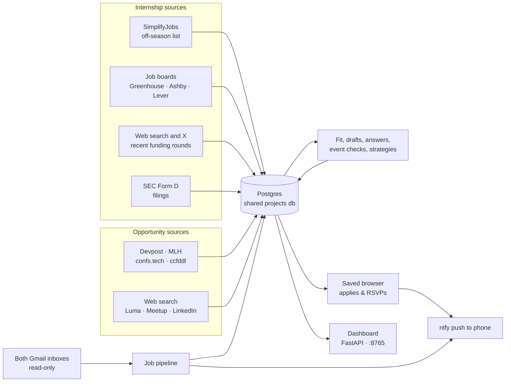

<div align="center">

# Winter 2027 Internship & Opportunity Agent

**Finds the internships worth my time, scores each against my resume, drafts the outreach and applies,<br>
then finds the hackathons, conferences and events worth going to, and tracks what comes back.**


[What it does](#what-it-does) · [How it fits together](#how-it-fits-together) · [Dashboard](#the-dashboard) · [Internship agent](#internship-agent) · [Opportunity agent](#opportunity-agent) · [Safety](#safety-and-privacy) · [Setup](#setup) · [Commands](#commands)


<sub>A startup's fit and draft, a posting's prepared answers, and the rules learned from notes. Every company and person shown is made up.</sub>

</div>

## What it does

A local-first assistant for Aarav Modi's Winter 2027 (January–April) software-engineering co-op
search. It runs on a home server with one dashboard and two agents.

| | What it does |
|---|---|
| **Internship agent** | Finds recently funded startups and open postings, scores each against the resume, finds the right people, drafts outreach, applies to complete Greenhouse / Ashby / Lever forms daily, and tracks every reply, bounce, interview and rejection from both Gmail inboxes. |
| **Opportunity agent** | Finds hackathons, tech conferences, research venues and networking events. It checks each for location, travel paid, effort and fit, picks sponsored hackathons you can realistically enter, applies or RSVPs where the site allows, and plans research and talk submissions from your real work. |
| **Shared** | A calendar of every deadline, event and follow-up, and **Ask**, a chat that knows your resume, website and GitHub. |

<table>
<tr>
<td width="33%" valign="top">

**Scored against the resume**

Each lead gets a fit score, the reasons for it, and what to lead with.


</td>
<td width="33%" valign="top">

**Drafts you edit, then send**

Sending takes a second confirming click, and a guessed address has to be checked first.


</td>
<td width="33%" valign="top">

**Application answers, prepared**

Written from the resume for a posting's real form, then submitted in a saved browser session.


</td>
</tr>
</table>

**Recently funded startups first.** Web search finds funding rounds from the last 60 days in
Canada, the USA and Europe. A result is kept only if its cited article loads and names both the
company and the founder.

<p align="center"></p>

**It learns from your notes.** "This one needs French, not applying" becomes a rule, and every
later lead is scored against it.

<p align="center"></p>

## How it fits together



| Part | Where | What it does |
|---|---|---|
| Internship sources | `sources/simplify.py`, `sources/startup_jobs.py`, `sources/startups.py`, `sources/form_d.py`, `x_search.py` | Postings, recently funded startups and Form D founders; every lead keeps its source URL |
| Opportunity sources | `opportunities/feeds.py`, `opportunities/run.py` | Hackathon, conference and research-deadline feeds, plus a cited web search for events |
| Storage | `db.py`, `leads/store.py`, `opportunities/store.py` | One `(id, key, data jsonb)` table per kind in the shared `projects` Postgres database (`DATABASE_URL`); files in `data/` without it |
| AI | `ai.py`, `opportunities/ai.py`, `chat.py` | OpenAI structured output, validated by Pydantic: fit, drafts, application answers, event checks, submission strategies, the Ask chat |
| Browser | `applications/browser.py`, `opportunities/apply.py`, `opportunities/browser.py` | Playwright in a saved profile: job forms, event registrations and RSVPs, sign-ins |
| Mail | `mailer.py`, `mailbox.py`, `followup_run.py`, `pipeline.py` | Sends after a click, follow-ups, and read-only inbox tracking |
| Dashboard | `dashboard/app.py`, `dashboard/index.html`, `dashboard/dashboard.css` | Every view below; local or Tailscale only |
| Calendar | `agenda.py` | Deadlines, event dates and follow-ups from both agents, and the `.ics` export |

### Every day on the server

The server is a MacBook on Tailscale. Docker Compose runs the dashboard at
`http://100.76.57.23:8765`, and pushing to `main` deploys within a minute.

| When (Toronto) | What | How |
|---|---|---|
| 7:30 AM | Scrape postings → Form D founders → refresh opportunity feeds (+ event search on Mondays) → check 10 events → pick hackathons → apply to events marked Interested | `scripts/run-daily-job-scrape.sh` (systemd) |
| 8:00 AM | Submit 20 job applications, lowest fit first | `scripts/run-daily-applications.sh` (systemd) |
| Every 30 min | Record replies and bounces in both inboxes; push new outreach replies | `leads followups --check-only` (systemd `internship-inbox-check`) |
| Every 30 min | Scan both inboxes into the Job pipeline; push assessments, interviews, offers | Inside the dashboard |
| Each new email | Push replies to the main inbox | n8n ([`n8n/README.md`](n8n/README.md)) |
| Weekdays 9:30 AM | Follow-ups to people with no reply after 5 days, at most twice (only with `FOLLOWUPS_ENABLED=true`) | n8n |

Long jobs share one lock, so two never use the saved browser at once. Every ntfy push is kept
and shown by the messages service in the
[home-dashboard](https://github.com/aaravhmodi/home-dashboard) repo.

## The dashboard

```text
uv run internship-agent dashboard        # http://127.0.0.1:8765
```

| Section | View | What's there |
|---|---|---|
| Both agents | **Calendar** | Apply-by dates, deadlines, event days and follow-ups on a month grid ([more](#calendar)) |
| Internship agent | **Job pipeline** | Funnels, trends, takeaways and a board of every company by its latest email ([more](#job-pipeline)) |
| | **Startups** · Early · Mid | Recently funded startups by fit |
| | **Big companies** | Open postings from the SimplifyJobs list |
| | **Applied · Contacted · Skipped** | Your pipeline as lists |
| | **Your rules** | Rules learned from your notes |
| Opportunity agent | **Hackathons · Tech conferences · Research venues · Networking** | Everything found, soonest first, with travel / fit / effort badges once checked |
| | **Travel paid ✈** | Events that pay some or all of your way |
| | **Picked for you ★** | Hackathons picked and applied to for you |
| | **Interested & registered · Skipped** | Your plans |

Select anything for its detail panel. Leads show fit, people, drafts, application answers and
an **Inbox** timeline; events show "Is it worth going?", the application result and a
submission strategy.

**Notes** (bottom of the side panel). Type why you're skipping something or what you want more
of, for example "this one needs French, not applying". With a company selected, the note is
saved on it, and its status changes if you say you skipped, applied or reached out. Reusable
notes become rules ("Skip roles that require French", "Prefer early-stage AI startups"), applied
whenever leads are scored. A rule can lower or raise a score, or auto-skip a lead that clearly
breaks it; company-wide boilerplate doesn't count. "Re-check to-do leads" re-scores everything.

**Ask ✦** (bottom right) is a chat that knows you; see [Ask](#ask).

## Internship agent

### Finding leads

- **Startups** (early = pre-seed/seed, mid = Series A–D) are the priority. "Search for startups"
  runs OpenAI web search for funding rounds from the last 60 days in `SEARCH_REGIONS`, through
  funding news, X posts (Grok's `x_search` when `XAI_API_KEY` is set) and LinkedIn posts. A
  result is kept only if its cited article loads and names both the company and the founder.
  Each new startup's public job board is checked for open intern and co-op roles.
- **Big companies:** open Winter 2027 postings from the public
  [SimplifyJobs off-season list](https://github.com/SimplifyJobs/Summer2027-Internships/blob/dev/README-Off-Season.md).
  "Mark applied" tops the open list back up to `TARGET_OPEN_POSTINGS` (15); postings you
  applied to or skipped are never re-added.
- **SEC Form D** (`leads form-d`): the SEC's free daily index of Form D filings, keeping US tech
  companies incorporated in the last five years that raised $250K–$50M. The signing officer is
  the contact. The website is found without AI by trying likely domains, and counts only if it
  names someone on the filing or the legal name. Runs after the morning scrape over the last
  three days; `--days 365 --min-usd 5000000` backfills a year of midsize raises.
- **Founders on X** (`/find-founders 10 AI infra` in Claude Code): reads X search, founder
  profiles and funding news read-only through Claude in Chrome, writes
  `data/leads-inbox.json`, then `leads import` / `score` / `draft-all`.
- **People** ("Find people", automatic for new startups): about five more people at the company,
  chosen by its size. That means founders and first engineers early; engineering managers,
  recruiters and engineers mid-stage; campus recruiters and the team at a big company. Each
  needs a source page naming them and the company. `leads team-contacts` adds a recruiter and a
  senior engineer at every startup that raised $15M+.

### Scoring

Fit 0–100 against the resume (`RESUME_PATH`) and [`candidate_context.md`](candidate_context.md),
with reasons, concerns and talking points, using `OPENAI_MODEL` (default `gpt-6-luna`). Scoring
reads each posting's description so rules like "requires French" can be checked. Token counts,
never prompt content, are logged to `openai_usage`.

### Outreach

- **Send email** sends from Gmail after a second confirming click. A guessed address needs
  "I've checked this address" ticked, and a lead is never emailed twice unless you choose
  "Send again".
- **Addresses.** `leads site-emails` reads each startup's own pages for addresses at its domain;
  a published address with the person's name replaces a guess. `leads guess-send --limit 40`
  lists the format most likely to reach each founder (`first@`, `first.last@`, …), learned
  from past deliveries and bounces, and emails only with `--send`. People at the same company
  are emailed only once the CEO's guess, or any published personal address there, has proven
  the format. A format that bounced there is never tried again, and a shared careers inbox is
  the fallback after two bounces.
- **Company inboxes.** `leads inbox-send --limit 20` emails startups' published shared inboxes
  (careers@, jobs@, … hiring ones first), each as its own lead greeting "{company} team",
  skipping companies where someone already replied. It also only lists without `--send`.
- **Two inboxes.** New outreach goes from `OUTREACH_GMAIL_ADDRESS` when set, so bounces stay off
  the main Gmail.
- **Follow-ups** go out after 5 days without a reply, at most twice, as a reply in the same
  thread with fixed wording, only with `FOLLOWUPS_ENABLED=true`. They never go to someone who
  replied or whose address bounced.
- **LinkedIn and X:** the dashboard copies the connection note or DM and opens the profile; you
  send it.

### Applications

Run `uv run playwright install chromium`, then `uv run internship-agent leads browser-login` once
to sign in to the job sites you use.

- **Daily:** answers and a cover letter are prepared from the posting's real form. Personal
  answers come from the answer bank and the rest are written by AI. Then 20 complete Greenhouse,
  Ashby and Lever forms a day are submitted, lowest fit first, skipping terms outside
  January–April (`--skip-strong` leaves strong fits for you).
- **Auto-apply** on one job applies even outside January–April, rewriting the term, dates and
  cover letter to match.
- **Proof:** **✓ Submitted** shows the time, the employer's own confirmation line and a
  screenshot of their confirmation page. Anything not confirmed is `uncertain` and never retried
  on its own. "Wasn't submitted, allow retry" reopens it once you've checked. A Greenhouse
  emailed security code is read from Gmail.
- **Left for you:** Workday, CAPTCHA pages, unsupported sites, forms with missing required
  answers, and anything needing a transcript.

### Job pipeline

The **Job pipeline** view reads both Gmail inboxes every 30 minutes and shows how the search is
converting:

- headline numbers: emailed, delivered, replies, applied, interviews, rejections;
- an outreach funnel (emailed → delivered → replied → interview) and an applications funnel
  (applied → confirmed by email → heard back → interview), with the drop-off at each step;
- takeaways computed from the numbers, not by AI. These cover how often guessed addresses bounce,
  reply rate by company stage, applications recorded as "not confirmed" that the employer did
  confirm by email, what needs you, who is done with follow-ups, and how fast replies come;
- three weeks day by day: what you sent, and what came back (confirmations, bounces, replies,
  rejections);
- replied / no reply / bounced by address type, by inbox and by company stage;
- a board of every company, one column per stage of its latest email: Waiting, Replied,
  Assessment, Interview, Offer, Rejected, Bounced. Click a card for the lead and its **Inbox**
  timeline.

It reads the inboxes read-only, looking back `PIPELINE_DAYS` (45). It downloads only new mail
from recruiting systems (Greenhouse, Lever, Ashby, Workday, CodeSignal, …), from people at
companies you emailed, bounce notices, and mail whose subject is about an application or
interview. Each email is classified with deterministic patterns and matched to its lead by
address, then domain, then company name. Only the sender, subject, stage and a 240-character
snippet are stored; never the full email. "Check inboxes now" scans on demand.

## Opportunity agent

### Sources

| Kind | Where it comes from |
|---|---|
| Hackathons | [Devpost](https://devpost.com/hackathons)'s JSON API (online, plus in-person nearby) and [MLH](https://www.mlh.com/seasons/2027/events)'s season page |
| Tech conferences | [confs.tech](https://confs.tech)'s data on GitHub (`CONFERENCE_TOPICS`), with talk-proposal deadlines |
| Research venues | [ccfddl](https://ccfddl.com) deadlines with CORE/CCF rank (`RESEARCH_AREAS`: AI, SE, HCI, DB, interdisciplinary) |
| Networking events | OpenAI web search of Luma, Eventbrite, Meetup, LinkedIn and X, TechTO, Communitech, DMZ and UW clubs near `EVENT_CITIES` (Mondays) |
| Anything else | `/find-opportunities` in Claude Code reads LinkedIn, X and Luma read-only and imports what it finds |

Structured feeds come first because they can't invent an event, and each is read on its own so
one changing format doesn't lose the rest. Only upcoming events that are online, in
`SEARCH_REGIONS` or in `EVENT_CITIES` are kept. A web-search event is kept only if it's dated in
the window and its own page loads and names it. Re-running never overwrites an event you marked.

### Is it worth going?

"Check details" (10 a day automatically, `DAILY_OPPORTUNITY_CHECKS`) reads the event's own pages
and records:

- where it is, and whether it's in person, online or hybrid;
- the apply-by date;
- whether they pay for travel: covered, partial, none or not stated, with what's paid, how to
  apply and the source page (a travel claim counts only if that page names the event);
- the cost to you, and the effort: light, moderate or heavy, with hours;
- eligibility, sponsors, prizes, and how work gets recognized;
- how your projects apply, with a fit score, and what makes it worth the trip.

Hackathons are checked first, online and nearby before far away, research venues last.

### Picked for you

After the checks, hackathons that clear this bar are marked Interested with the reason, so the
same morning run applies:

- **realistic:** nothing rules you out (a clear "no"; "unclear" is fine), still open, fit at
  least `AUTO_PICK_MIN_FIT` (70), and "heavy" only if online, where you choose the scope;
- **sponsored with recognition:** named sponsors or stated prizes, plus judging, awards, a
  showcase or interviews for winners;
- **reachable:** online from anywhere, in person in Canada or `EVENT_CITIES`, or anywhere that
  pays some or all of the travel.

It never touches anything you marked or skipped. Skip a pick to undo it;
`AUTO_PICK_HACKATHONS=false` turns it off.

### Applying for you

Hackathons and networking events marked **Interested** are applied to or RSVPed each morning,
and "Apply for me now" does one immediately. A browser agent works through the site one page at
a time: Devpost, an MLH event's own site, Luma, Eventbrite, Typeform or a Google Form. It fills
the form from `candidate_context.md`, the resume and the answer bank. Personal details are filled
in locally; the model only sees the question names. The result card shows what it did page by
page, with a screenshot when the event confirms it. See [Safety](#safety-and-privacy) for the
rules it can't break.

Devpost and MLH sign-in put a Cloudflare check in front of automated browsers, so those usually
come back "Needs you". Events with their own form, and Luma RSVPs, go through.

**Signing in** (once, on the laptop: it needs a screen):

```text
uv run internship-agent opportunities sign-in --server http://100.76.57.23:8765
```

A browser opens on Luma, Eventbrite, MLH and Devpost. For each, it types `GMAIL_ADDRESS`, reads
the code or link the site emails (read-only from Gmail), and creates the account if there isn't
one. It waits for you at any "verify you're human" box, and leaves anything it can't finish open
for you. Then those four sites' cookies only go to the server's application browser.

### Submission strategy

On a research venue or conference, "Plan a submission" reads the live call for papers. It lists
the tracks an undergraduate can realistically enter: student research competitions, posters,
late-breaking work, demos, non-archival workshops, undergraduate consortia and talk proposals.
Each comes with its deadline, format, eligibility and source page; a track whose page doesn't
name the venue is dropped. It then picks which of your projects to submit and what's missing,
lays out a dated plan back from the deadline, and lists ways to attend affordably. It never
invents results. Talk proposals and research submissions are never sent for you.

## Shared

### Calendar

One month grid for both agents, with a list of what's next:

- **Apply by:** from event checks and any posting deadline;
- **Deadlines:** submissions, papers, talk proposals;
- **Events:** event dates (weeks-long online ones only on their first day);
- **Follow-ups:** when each emailed person is due one.

By default it shows your follow-ups, events you marked, and checked events with fit 75+ or
travel paid. Click a kind in the legend to see all of it. **Download .ics** exports the same
items for Google, Apple or Outlook Calendar (`/api/calendar.ics`, `?everything=true` for all),
with IDs that stay stable across exports.

### Ask

**Ask ✦** is a chat that knows:

- your profile: `candidate_context.md`, the resume, your website (`WEBSITE_URL`,
  `WEBSITE_PAGES`), and every public GitHub repo (`GITHUB_USER`) with README excerpts. It's
  rebuilt at most daily;
- whatever lead or opportunity you have open;
- read-only tools to search stored opportunities and leads, read a repo's README, and search
  the web.

With a conference open, ask "what could I give a talk on here?" It picks your projects, drafts a
title and abstract, checks the call, and cites every claim ([GitHub: study-agent],
[website: experience], [resume]). It never invents experience. `CHAT_MODEL` sets the model
(default `gpt-6-luna`; `gpt-4o` works). The conversation stays in your browser.

### Outlook (optional)

Outlook mail and calendar are read through the
[Softeria Microsoft 365 MCP server](https://github.com/Softeria/ms-365-mcp-server) with
`--read-only --preset mail,calendar`, and the client calls only an allowlist of read tools.
`internship-agent inbox` groups recruiting emails by stage; `interviews --days 30` lists
interview-like events. `.mcp.json` registers the same server for Claude Code sessions here.

## Safety and privacy

- **Email** goes out only when you send it: the dashboard's Send after a second confirming
  click, or `guess-send --send` / `inbox-send --send`. Follow-ups are automatic only with `FOLLOWUPS_ENABLED=true`, at
  most twice, never after a reply or bounce.
- **Inboxes are read-only.** Gmail is read over IMAP with folders opened read-only, so nothing
  is marked read, moved or deleted. Outlook goes through a read-only MCP server.
- **Browser rules, in code:**
  - three checks before acting: the event's own site or a known platform, the page names the
    event, nothing asks for payment;
  - never a password, card or billing field, never a pay or checkout click, free tickets only;
  - stops at CAPTCHAs and bot checks, and never tries to get around them;
  - never ticks newsletter or marketing boxes;
  - "submitted" only when the page confirms it, and never retries anything unconfirmed on its
    own.
- **LinkedIn and X** are read only, never automated: no invitations, DMs, follows or posts.
- **Personal answers** come from the answer bank and are filled in locally; the AI sees question
  names, not your details. Logs never contain cookies, codes, form values or email bodies.
- **Every claim about you** in drafts, answers, strategies and chat comes from the resume,
  `candidate_context.md`, your website or GitHub, and is cited where shown.
- **The dashboard** answers only localhost and `DASHBOARD_ALLOWED_HOSTS` (the Tailscale
  address), and rejects cross-site requests.

## Setup

Requirements: Python 3.12, [uv](https://docs.astral.sh/uv/), Node.js (for the Outlook MCP server).

```text
uv sync
cp .env.example .env                       # then fill in the settings below
uv run playwright install chromium
uv run internship-agent leads browser-login       # sign in to job sites once
uv run internship-agent opportunities sign-in     # sign in to event sites once
uv run internship-agent dashboard
```

Gmail needs 2-Step Verification and an app password
(https://myaccount.google.com/apppasswords). Never use your normal Google password.

## Commands

```text
# Internship agent
internship-agent leads find-startups --stage early --stage mid --count 8
internship-agent leads scrape-jobs | form-d | team-contacts | site-emails
internship-agent leads import data/leads-inbox.json && leads score && leads draft-all
internship-agent leads guess-send --limit 40 [--send]
internship-agent leads inbox-send --limit 20 [--send]
internship-agent leads application-campaign --target 20 --lowest-first
internship-agent leads apply <key> --dry-run
internship-agent leads followups [--send | --check-only]
internship-agent leads list | show <key> | mark <key> <status>

# Opportunity agent
internship-agent opportunities refresh [--events]
internship-agent opportunities check [<url>...]
internship-agent opportunities list [--kind research]
internship-agent opportunities strategy <url>
internship-agent opportunities apply [<url>...] [--dry-run]
internship-agent opportunities sign-in [--site luma ...] [--server <dashboard>]
internship-agent opportunities mark <url> interested

# Outlook (read-only)
internship-agent outlook login | status
internship-agent inbox
internship-agent interviews --days 30
```

Prefix each with `uv run`. In Claude Code, `/find-founders` and `/find-opportunities` gather
leads from X, LinkedIn and Luma read-only.

## Configuration

Settings come from `.env` (see `src/internship_agent/config.py` for all of them).

| Setting | Default | What it does |
|---|---|---|
| `OPENAI_API_KEY` | | Scoring, drafts, answers, checks, strategies, chat |
| `OPENAI_MODEL` · `OPENAI_WRITING_MODEL` · `CHAT_MODEL` | `gpt-6-luna` | Models for search and scoring, writing, and Ask |
| `DATABASE_URL` | | The shared `projects` Postgres database; files in `data/` without it |
| `RESUME_PATH` · `CANDIDATE_CONTEXT_PATH` | `../website/public/ModiAaravResume.pdf` · `candidate_context.md` | What everything is grounded in |
| `GMAIL_ADDRESS` · `GMAIL_APP_PASSWORD` | | Main Gmail: sending, codes, inbox tracking |
| `OUTREACH_GMAIL_ADDRESS` · `OUTREACH_GMAIL_APP_PASSWORD` | | Second Gmail for new outreach |
| `FOLLOWUPS_ENABLED` · `FOLLOWUP_DAYS` | `false` · `5` | Automatic follow-ups |
| `SEARCH_REGIONS` · `EVENT_CITIES` | Canada, USA, Europe · Toronto, Waterloo, Kitchener, Mississauga, Hamilton | Where to look and what counts as nearby |
| `RESEARCH_AREAS` · `CONFERENCE_TOPICS` | AI, SE, HI, DB, MX · general, python, … | Research and conference feeds |
| `DAILY_OPPORTUNITY_CHECKS` | `10` | Event checks per morning |
| `AUTO_PICK_HACKATHONS` · `AUTO_PICK_MIN_FIT` | `true` · `70` | Picked for you |
| `PIPELINE_SYNC_MINUTES` · `PIPELINE_DAYS` | `30` · `45` | Job pipeline inbox scans |
| `GITHUB_USER` · `WEBSITE_URL` | `aaravhmodi` · `https://aaravmodi.ca` | Ask's profile |
| `XAI_API_KEY` | | Grok's X search for funding posts |
| `NTFY_TOPIC` · `DASHBOARD_URL` | | Phone pushes and the link they open |
| `DASHBOARD_ALLOWED_HOSTS` | | Extra hosts the dashboard answers (the Tailscale IP) |
| `OUTLOOK_ORG_MODE` | `false` | `true` for a uwaterloo.ca mailbox |

## Storage

Each kind of record is an `intern_agent_<name>` table, `(id, key, data jsonb)`, in the shared
`projects` Postgres database:

| Table | Holds |
|---|---|
| `leads` | Every startup, founder and posting, with fit, drafts, people and application state |
| `opportunities` | Every event and venue, with checks, strategies and application results |
| `pipeline` | One event per tracked email (sender, subject, stage, snippet) |
| `preferences` · `answer_bank` | Learned rules · saved personal answers |
| `sent_log` · `openai_usage` · `xai_usage` | What was sent · token counts (no prompts) |

Without `DATABASE_URL` the same records are files in `data/`, which is git-ignored.

## Development

```text
uv run pytest
uv run ruff check .
uv run mypy src
```

AI and browser output is validated with Pydantic at the boundary. Deterministic logic is
tested directly, and browser flows against fake pages.
