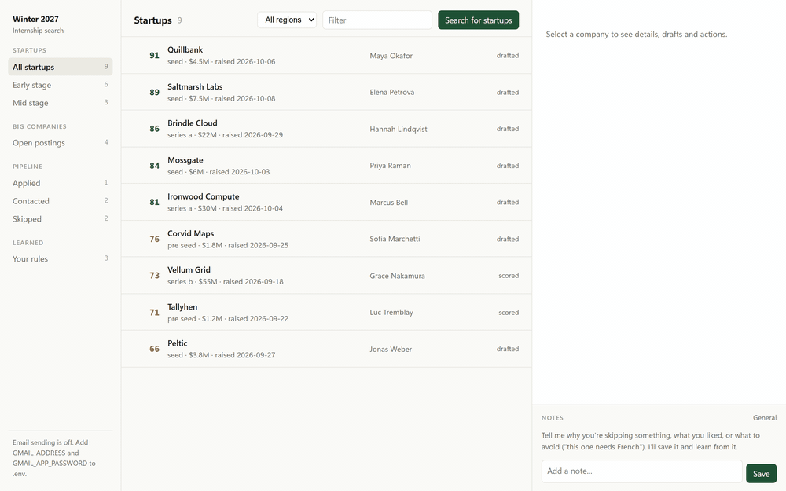
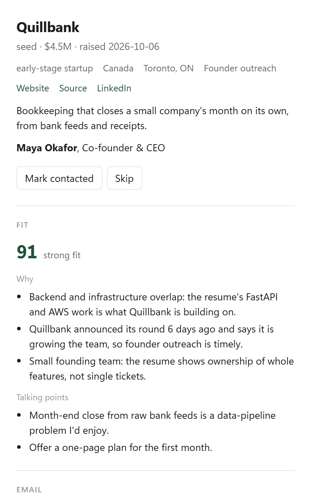
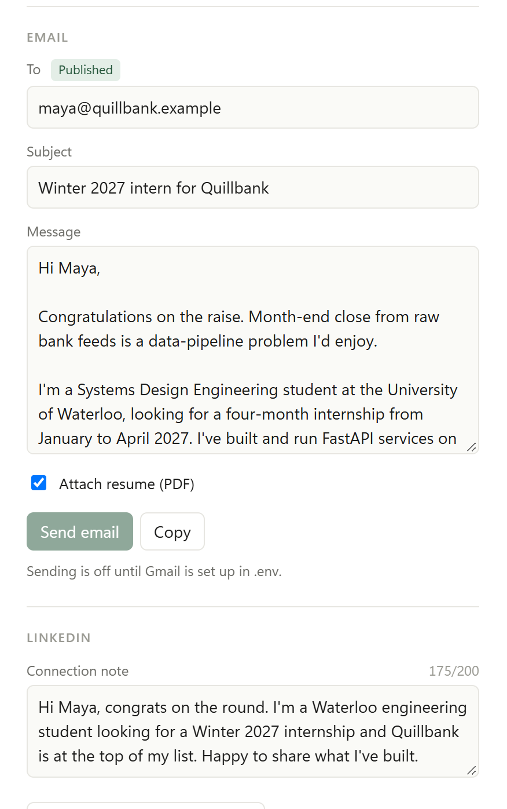
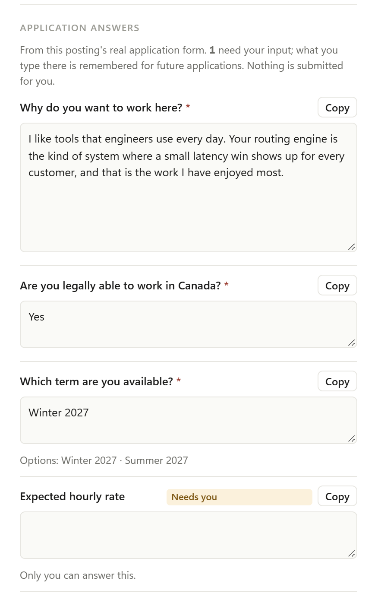
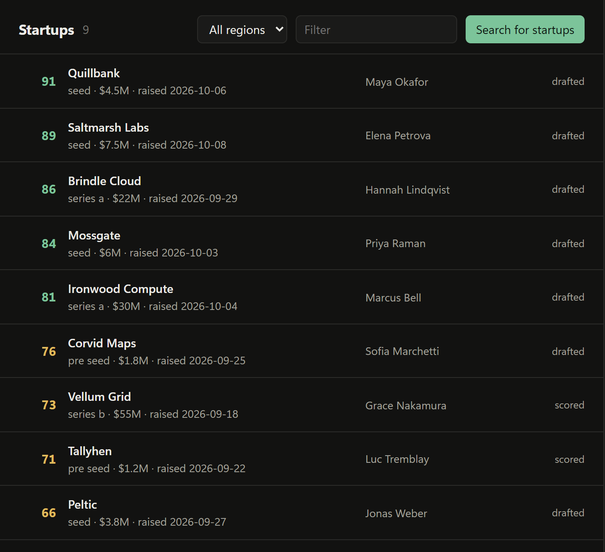
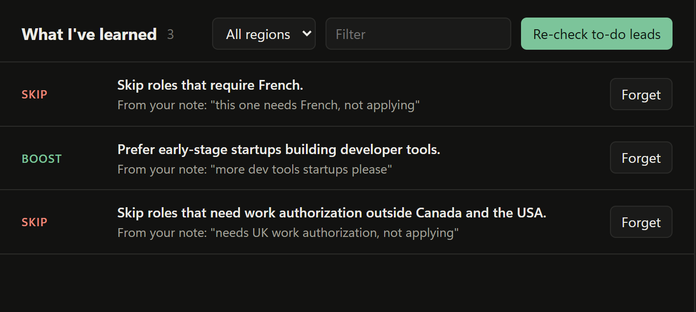
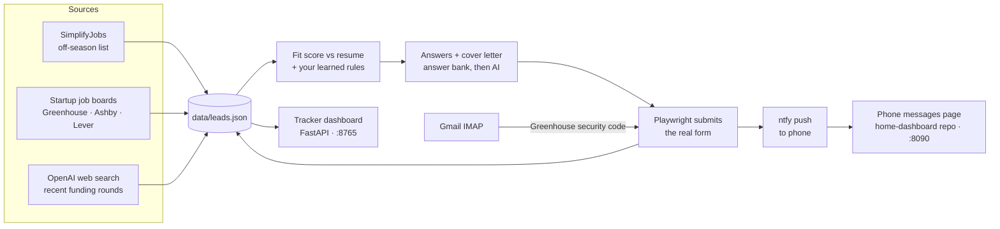

<div align="center">

# Winter 2027 Internship Agent

**Finds the internships worth my time, scores each against my resume, drafts the outreach, and applies.**<br>
Outreach emails are sent only after I confirm; applications go out daily for complete Greenhouse, Ashby and Lever forms.


[What it does](#what-it-does) · [Architecture](#architecture) · [Dashboard](#dashboard) · [Outlook](#outlook-integration-mcp) · [Development](#development)



<sub>A startup's fit and draft, a posting's prepared answers, and the rules learned from notes. Every company and person shown is made up.</sub>

</div>

## What it does

A local-first agent for finding Winter 2027 software-engineering internships, matching them against Aarav Modi's resume, and preparing application materials.

<table>
<tr>
<td width="33%" valign="top">

**Scored against the resume**

Each lead gets a fit score, the reasons for it, and what to lead with.



</td>
<td width="33%" valign="top">

**Drafts you edit, then send yourself**

Sending takes a second confirming click, and a guessed address has to be checked first.



</td>
<td width="33%" valign="top">

**Application answers, prepared**

Written from the resume for a posting's real form. Eligible, complete forms can be submitted by the saved browser session.



</td>
</tr>
</table>

**Recently funded startups first.** Web search finds funding rounds from the last 60 days in Canada, the USA and Europe. A result is kept only if its cited article loads and names both the company and the founder.

<p align="center"></p>

**It learns from your notes.** "This one needs French, not applying" becomes a rule, and every later lead is scored against it.

<p align="center"></p>

## Architecture



| Part | Where | What it does |
|---|---|---|
| Sources | `sources/simplify.py`, `sources/startup_jobs.py`, `sources/startups.py` | Collect Winter 2027 postings and recently funded startups; every lead keeps its source URL |
| Lead store | `leads/store.py`, `leads/schemas.py` | One JSON file (`data/leads.json`) holding leads, fit, drafts and application state |
| Scoring | `workflows.score`, `ai.py`, `leads/preferences.py` | Fit 0-100 from the resume and posting text; your notes become skip/boost rules |
| Answers | `workflows.prepare_application`, `leads/answers.py`, `sources/application_form.py` | Reads the posting's real form; personal questions come from `data/answer-bank.json`, the rest are AI-written |
| Submission | `applications/browser.py`, `applications/verification_mail.py` | Fills and submits the form in a saved browser profile; reads Greenhouse's emailed code from Gmail; marks anything it can't confirm `uncertain` and never retries it on its own |
| Daily run | `workflows.daily`, `leads application-campaign` | Scrape, score new postings, then submit 20 applications, lowest fit first; one ntfy summary |
| Dashboard | `dashboard/app.py`, `dashboard/index.html` | Browse leads, edit drafts and answers, Auto-apply one job (on its own term), reopen an attempt you confirmed never sent |
| Outreach | `mailer.py`, `leads/sending.py`, `followup_run.py` | Gmail sends after a confirming click; follow-ups at most twice per person |

**On the server** (a MacBook on Tailscale), Docker Compose runs the dashboard at
`http://100.76.57.23:8765`. Pushing to `main` deploys within a minute. Systemd timers run
`scripts/run-daily-job-scrape.sh` at 7:30 AM and `scripts/run-daily-applications.sh` at 8:00 AM
Toronto time. n8n handles replies and follow-ups. Every ntfy push, from this agent or any other
app, is kept and shown by the separate messages service in the
[home-dashboard](https://github.com/aaravhmodi/home-dashboard) repo.

## Current setup

- Resume source: `../website/public/ModiAaravResume.pdf`
- Tailoring context: [`candidate_context.md`](candidate_context.md), including public portfolio
  facts and clearly marked candidate-provided notes
- Outlook Email and Outlook Calendar: optional, read-only inputs when connected
- LinkedIn: public-page discovery only until a supported connector is available
- Application submission: browser driven for Greenhouse, Ashby, and Lever postings; Workday,
  CAPTCHA pages, unsupported sites, and forms with unanswered required fields are skipped

## Outlook integration (MCP)

Outlook mail and calendar are read through the
[Softeria Microsoft 365 MCP server](https://github.com/Softeria/ms-365-mcp-server),
launched over stdio with `--read-only --preset mail,calendar`. The Python client in
`src/internship_agent/outlook/` additionally only calls an allowlist of read tools
(`verify-login`, `list-mail-messages`, `get-mail-message`, `get-calendar-view`).
Microsoft's official Work IQ Mail/Calendar MCP servers were not used because they need
an M365 Copilot license and tenant admin registration, and don't support personal accounts.

Requirements: Python 3.12, [uv](https://docs.astral.sh/uv/), Node.js (for `npx`).

```text
uv sync
cp .env.example .env              # set OUTLOOK_ORG_MODE=true for a uwaterloo.ca mailbox
uv run internship-agent outlook login    # device-code sign-in; tokens go to the OS credential store
uv run internship-agent outlook status
uv run internship-agent inbox            # recruiting emails grouped by stage
uv run internship-agent interviews --days 30
```

`.mcp.json` registers the same read-only server for Claude Code sessions opened in this
folder. Run the login step first so it can reuse the cached token.

## Dashboard

```text
uv run internship-agent dashboard        # http://127.0.0.1:8765 (local only)
```

Two searches, shown separately:

- **Startups** (early = pre-seed/seed, mid = Series A-D) are the priority. "Search for startups"
  runs OpenAI web search for funding rounds from the last 60 days in Canada, the USA and Europe
  (`SEARCH_REGIONS`), each through funding news, X posts and LinkedIn posts. Each new startup's
  public job board (Ashby, Greenhouse, Lever) is checked for open intern/co-op roles. A result is kept only if its cited
  article loads and names both the company and the founder. Also from the CLI:
  `leads find-startups --stage early --stage mid --count 8`.
- **Big companies**: open Winter 2027 postings from the public
  [SimplifyJobs off-season list](https://github.com/SimplifyJobs/Summer2027-Internships/blob/dev/README-Off-Season.md).
  "Mark applied" tops the open list back up to `TARGET_OPEN_POSTINGS` (default 15); postings
  you applied to or skipped are never re-added.

Select a company to see its fit score and reasons, contact, and editable drafts:

- **Send email** sends from Gmail after a second confirming click. Guessed addresses need
  "I've checked this address" ticked; a lead is never emailed twice unless you choose
  "Send again". Sends are logged to `data/sent-log.jsonl`. Setup: turn on 2-Step Verification,
  create an app password at https://myaccount.google.com/apppasswords, and put it in `.env` as
  `GMAIL_APP_PASSWORD` (with `GMAIL_ADDRESS`). Never use your normal Google password.
- **LinkedIn**: copies the connection note and opens the profile (or a people search). LinkedIn
  forbids automated invitations, so you paste and send it.
- **More people to connect with**: "Find people" runs a web search for about five other people
  at the company, chosen by its size: founders and first engineers at an early-stage startup;
  engineering managers, recruiters and engineers (not the co-founders) at a mid-stage one;
  campus recruiters and the team's manager and engineers at a big company. Each needs a source
  page that names them and the company; a LinkedIn source cannot be read by a script, so check
  the profile before you send. New startups get this automatically when they are found.
- **Applications**: run `uv run playwright install chromium`, then
  `uv run internship-agent leads browser-login` once to sign in to the job sites you use.
  The daily run prepares tailored answers and submits 20 complete Greenhouse, Ashby, and
  Lever forms a day, lowest fit score first, and skips terms outside January-April.
  **Auto-apply** on a job applies to that one job even outside January-April: its term,
  availability and date answers and the cover letter are rewritten to match that posting.
  After a submit, the job shows a result card: **✓ Submitted** with the time, the employer's
  own confirmation line and a screenshot of their confirmation page (kept in
  `data/application-browser/confirmations/`), or the reason it wasn't submitted.
  **Wasn't submitted, allow retry** reopens an `uncertain` attempt after you have checked
  your email and the job site. Workday, CAPTCHA pages, unsupported sites, and forms
  with missing required answers are left for you; the ntfy summary reports submitted and
  blocked/failed counts. `internship-agent leads apply <company/contact-key> --dry-run` fills
  a form without submitting it.
  The server scrapes at 7:30 AM Toronto (then adds Form D founder leads, below) and runs
  applications at 8:00 AM through systemd
  timers (20 lowest-scored by default; `--skip-strong` leaves green strong fits for you).
  The daily run scores only new eligible postings and reuses prepared materials. Compact job context and GPT-6 Luna keep
  AI token usage low.
  Token counts for scoring, answers, and cover letters are recorded without prompt content in
  `data/openai-usage.jsonl`; the ntfy summary includes a token-based cost estimate.

**Notes (bottom of the side panel).** Type why you're skipping something or what you want
more of, e.g. "this one needs French, not applying". With a company selected, the note is saved
on it and its status is updated if you say you skipped, applied, or reached out. The AI also
turns reusable notes into rules ("Skip roles that require French", "Prefer early-stage AI
startups"), listed under **Learned > Your rules**, where you can forget them. Rules are applied
whenever leads are scored: scoring reads each posting's description, lowers or raises scores
for downrank/boost rules, and auto-skips leads that clearly break a skip rule (company-wide
boilerplate does not count). "Re-check to-do leads" re-scores everything against your rules.

The server only answers requests from localhost (and the hosts in `DASHBOARD_ALLOWED_HOSTS`,
the Tailscale address on the home server) and rejects cross-site requests, because it can send
email and submit applications.

## Founder leads (X.com)

Find founders who recently raised (pre-seed to Series A) and might take a Winter 2027 intern:

1. In Claude Code, run `/find-founders 10 AI infra`. Claude uses Claude in Chrome to read
   X search, founder profiles and funding news (read-only: no posts, likes, follows or DMs),
   and writes `data/leads-inbox.json`. Every lead must cite a `source_url` for the raise.
2. `uv run internship-agent leads import data/leads-inbox.json`: validates and dedupes.
3. `uv run internship-agent leads score`: OpenAI (`OPENAI_MODEL`, default `gpt-6-luna`)
   scores fit 0-100 against the resume at `RESUME_PATH`, with reasons and concerns.
4. `uv run internship-agent leads list`: ranked by fit, then stage, then recency.
5. `uv run internship-agent leads draft <key>`: drafts an X DM and an email. Nothing is sent;
   after you send it yourself, run `leads mark <key> contacted` (or `skipped`).

Leads, the resume text cache and the inbox file stay local and are git-ignored.

## Founder leads (SEC Form D)

`uv run internship-agent leads form-d` reads the SEC's free daily index of Form D filings
(no key or account; `GMAIL_ADDRESS` is sent as the contact the SEC asks for) and keeps US tech
companies incorporated in the last five years that raised $250K–$50M. The officer who signed
the filing is the contact. One OpenAI web search per new company finds its website (dropped if
the site doesn't name the company) and the founder's own email if a public page shows it;
otherwise the email is a `first@domain` guess marked unverified. New leads get open roles from
their job board and a fit score. The server runs it after the 7:30 AM scrape, reading the last
three days of filings; each new company costs about a cent.

## Other connectors

Gmail, Google Calendar and Google Drive are claude.ai connectors available to Claude Code
sessions; they are not called from the Python app.

## Development

```text
uv run pytest
uv run ruff check .
uv run mypy src
```

## Planned commands

```text
internship-agent setup
internship-agent scan --season winter-2027
internship-agent matches
internship-agent prepare <job-id>
internship-agent applications
```

The initial build will store job listings, source URLs, resume evidence, fit scores,
tailored resume suggestions, and draft cover letters locally. It will deduplicate
listings across company sites and public job boards and preserve the original source
for every recommendation.
